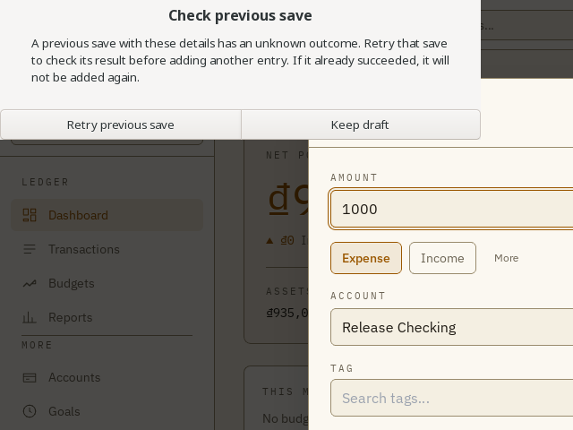
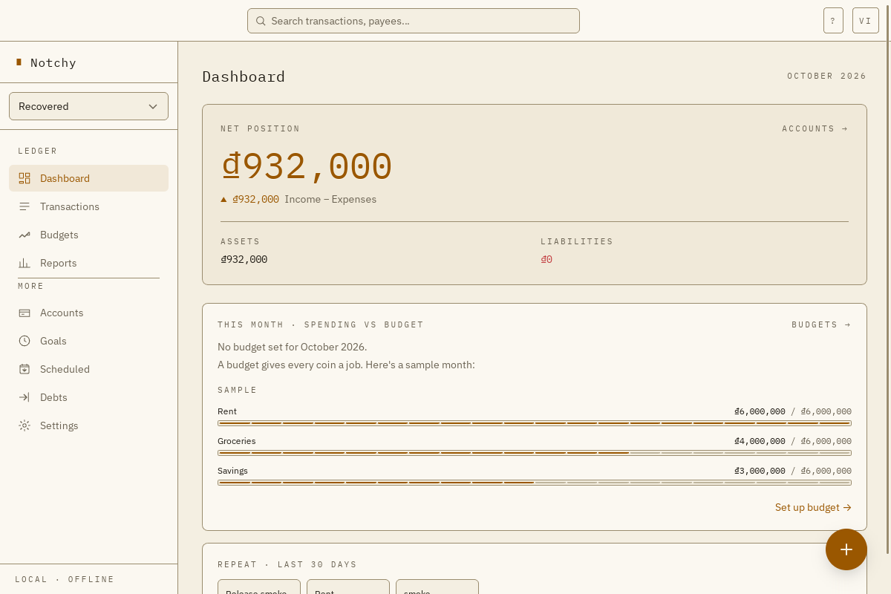

# Production fix verification — Notchy 0.2.2

**Serves:** STORY-009, STORY-013, STORY-015, STORY-023

Linux package acceptance passed. Application source `ea2faee8be447f14b04de8655d18c4c0ceab5480`
was merged through [PR #42](https://github.com/baoviettran/notchy/pull/42) into
`main` at `6dc2ec97ce541ff97ea764376d209d9e65ca736e`. The application, locale,
dependency and workflow trees are identical between these revisions. Subsequent
acceptance documentation does not alter the packaged application. The release tag,
workflow and published asset digests are authoritative for publication status.

## Closure and distribution decision

| Finding | Result and evidence |
| --- | --- |
| R1 interrupted schedule posting | Fixed. Browser regression first reproduced two 50,000 rows after failure/resume; atomic operation rolls back all rows before retry. Native real-SQLite failure tests cover advancement failure for income/expense/transfer, later-occurrence rollback, cap/resume and concurrent requests. Packaged native command replay posts once; restart does not repost. |
| R2 Windows directory durability | Open. Windows was unavailable. Windows/macOS/AppImage are excluded; no cross-platform durability claim. Task4 uses its explicit Linux-only fallback. |
| R3 lost-response retry | Fixed. All39 receipt-backed financial commands require caller OperationId. Persistent fingerprint/ULID ownership survives reload and session-generation changes while isolating profile identity. Packaged UI smoke commits natively, injects response loss, retains the draft, cancels and explicitly retries without another write, then saves a new identical intent. |
| R4 release gates | Fixed in tooling. Failed E2E aborts packaging; tag workflow reuses mandatory CI for that revision and waits before draft creation. New-tag coverage uses a valid prior tag/root comparison. Final tag workflow must pass before publication. |
| R5 backup policy | Manual policy retained and documented. No automatic routine backup/retention or sync was added. |

Supported acceptance matrix: unsigned **RPM on Fedora44 x86_64** (primary) and
**DEB on Ubuntu24.04 x86_64**. Both run actual installed Tauri binaries with native
SQLite and IPC. Tests use isolated rootless containers/Xvfb; WebKit sandbox disablement
applies only inside those test containers. The user's live desktop/profile was not
modified. Host tray/menu behavior, physical disk exhaustion, signing, Windows and
macOS are not certified by these results.

## Final automated evidence

[GitHub CI39942868206](https://github.com/baoviettran/notchy/actions/runs/39942868206)
passed at the exact application source `ea2faee`:

- Node22.22.3 / pnpm10.11.0; unit/component **1,221 tests /145 files**.
- Production browser E2E **166/166**; local affected rerun after the Quick Add fix **31/31**.
- Rust **394** tests; all-target Clippy with warnings denied; generated bindings current.
- Svelte/TypeScript zero errors, three pre-existing Quick Add CSS warnings.
- Coverage82.32% statements,74.68% branches,76.52% functions,84.87% lines;
  changed-file floor passed. Native client100% statements /93.33% branches.
- Local release tooling15/15 and native SQLite cutover check passed.
- Required DB mutation gate:765 mutants, score88.89%,674 killed,6 timed out,
  73 survived,12 uncovered. The retained HTML report confirms these counts;
  passing configured thresholds does not mean complete fault detection.

Accepted CI logs are retained in
`artifacts/0.2.2/latest-main/evidence/gates/ci-ea2faee.log`. Mutation HTML is
`reports/mutation/mutation.html`. The initial concurrent build/E2E attempt lost
shared generated assets and was rejected; the accepted E2E rerun used a stable
production preview. The mutation startup range was corrected after upstream moved
prepareDatabase. Root personal CSV files were excluded from mutation sandboxes
and never read, staged or packaged.

## Installed package acceptance

Final accepted packages, built with `CARGO_BUILD_JOBS=2 pnpm tauri build --bundles deb,rpm`:

| Artifact | SHA-256 |
| --- | --- |
| Notchy-0.2.2-1.x86_64.rpm | `a646174f93f69f30d8b9c42136faba80d7fdffc1a937581b4d9556ac4393c631` |
| Notchy_0.2.2_amd64.deb | `47810ef067c8652ae82ad9abc18b964c1466b0558130d0ed945944a36e42b159` |

The installed RPM and DEB executables both match the build executable:
`db85b67769f3676a736a52d92b35edf098abc9d8a722f628c165838cc96a3c91`.
`rpm -V notchy` and `dpkg -V notchy` passed. Version0.2.2, schema7.

Evidence under `artifacts/0.2.2/latest-main/evidence/`:

| Journey | Result / evidence |
| --- | --- |
| Fresh profile + finance | Income, expense, transfer and atomic schedule command/replay preserve expected balances. Native-results JSON on both OSes records7 transactions and balances832000/100000. |
| Actual Svelte save recovery | Callback fault occurs after native commit; Keep draft makes no write; explicit retry returns original transaction; a new identical form creates a new transaction. Screenshots02–06 and native_ui_retry_ids. |
| Quick Add | Real Ctrl+Shift+N focus and save passed after main-window setup; screenshot07 and quick_add_save. |
| Profile boundaries | Create/switch A/B; B starts empty; stale A session rejected; A ledger unchanged. Restore as new preserves original IDs/balances; inactive reset produces verified snapshot; inactive delete leaves A and Recovered intact. |
| Backup/export/restore | Native routine backup, SQLite export, inspect/restore-as-new, source hash unchanged and all7 table CSV exports passed. Synthetic data only. |
| Process restart | `fedora-accepted/restart-results.json` and `ubuntu-accepted/restart-results.json`: same restored profile, new generation, exact transaction rows and balances, no schedule repost. |
| Native file picker | Real GTK Open/cancel/reopen/cancel passed on both installed packages after restart. |
| Legacy upgrade | `upgrade/upgrade-results.json`: schema6 ledger captured from the actual published0.2.0 package adopts into exactly one profile; preserves all account/transaction IDs, balances850000/100000, allocated budget100000 and Vietnamese locale. Schema7 plus verified schema6 upgrade snapshot. |
| Legacy archival backup + restart | Backup bytes remain SHA256 `751893999a6c12873150bc2305912883a783a9df9ad42214c29c8177ea818eda`. First and second upgrade results retain one identical profile ID with a new session generation; ledger remains intact. |

Fresh profile isolation and finance acceptance are in
`fedora-accepted/native-results.json` and `ubuntu-accepted/native-results.json`.
Screenshots are retained beside them. The upgrade input came from the real
published0.2.0 ledger's pre-upgrade snapshot, not a package-manager marker.
Earlier pre-rebase packages and failed debug attempts outside `latest-main` are
superseded and must never be uploaded as this release's accepted artifacts.

## Implementation and review record

The39 receipt commands are enumerated in `src/lib/native/invoke.ts`: account,
transaction single/batch/bulk/duplicate, bucket/tag, budget, goal, rule/learned,
debt write-off, reconciliation and schedule operations. Reads, preferences and
profile/lifecycle filesystem operations do not gain financial receipt semantics.
Pending storage contains only request SHA256 fingerprints and operation ULIDs,
not financial payloads. Profile session generation guards native execution;
profile identity scopes retry ownership. NativeAppError conversion preserves local
pending-save errors. Stateful locale boundaries remain intact.

Six Important findings from independent whole-change review were fixed with
regressions: late completion erasing newer intent ownership, duplicate hashing
mutable source state, learned upsert switching receipt commands, reconciliation
recomputing discrepancy/omitting notes, validation preceding receipt replay, and
new-tag coverage using a zero SHA. Budget copy now owns all allocation writes
inside one receipt transaction. Target IDs are included in request hashes.
A separate integration review after rebase found no Critical/Important findings.

Native smoke additionally reproduced dialog JS2.2.0 versus Rust2.7.1 command
incompatibility. JS is now pinned2.7.1, with native confirmation permissions and a
release-tooling command regression. The original hook attempted to modify a
read-only invoke property and was invalid; accepted tests intercept only the
mutable callback Map after the real commit. No production fault injector was added.

Post-rebase native smoke also reproduced Quick Add remaining unready after main
completed onboarding without a session change. A failing component test preceded
refreshing profile settings on focus;8/8 Quick Add component tests and the final
full suite passed, followed by installed package acceptance.

Implementation landed coherently in `ccb3136`, `8123226`, `6e97e03`, `ea2faee`;
PR42 merged all application changes into main. Earlier history before rebase is
not the release source. The existing single-row transfer model and schema7 were
preserved. Windows filesystem work was explicitly deferred, not silently passed.

## Native screenshots

